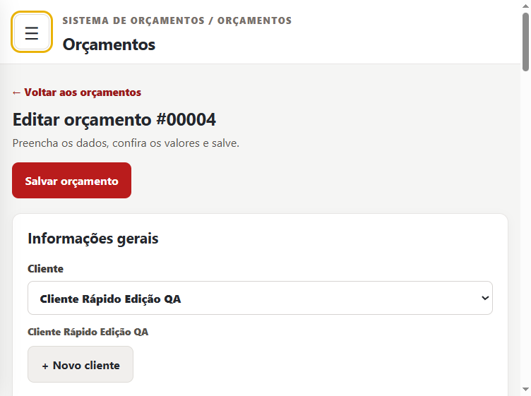
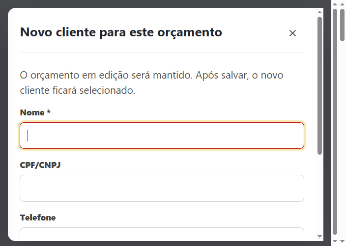
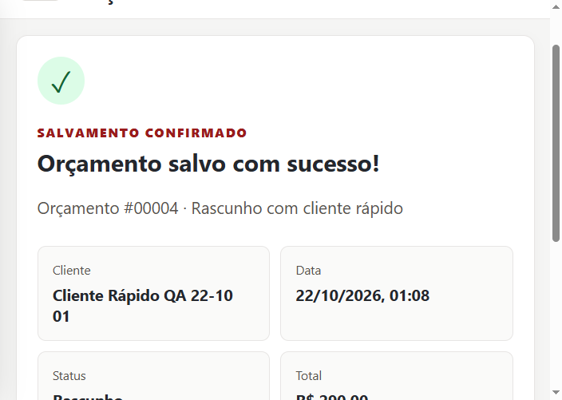

# Elétrica Borges Desktop — Engineering Case Study

**Commercial Windows desktop software · Version 1.1.0 · Completed and packaged for controlled delivery**

Elétrica Borges Desktop is a local quotation system for a Brazilian electrical-services workflow. It supports the path from customer registration to an itemized quotation, A4 PDF, and print dialog. The application was built and packaged for Windows x64. Acceptance checks on the customer's computer remain pending; this case study does not claim a completed customer-site rollout.

This repository contains **documentation, selected QA screenshots, and two edited demonstrations**. The commercial source, installer, database, licensing tools, keys, and customer information are private.

## What was implemented

| Area | Delivered behavior |
| --- | --- |
| Customers and catalog | Customer records; services and materials; CPF/CNPJ and phone input validation. |
| Quotations | Catalog and manual items, fractional quantities, calculated totals, fixed or percentage discounts, drafts, editing, duplication, history, archive, trash, and restore. |
| Output | A4 PDF preview/export and a visible Windows print dialog. A post-save screen provides the next actions. |
| Local operation | SQLite storage, backup and validated restore; core workflows do not require a development server or internet. The optional WhatsApp link requires a connection. |
| Usability | Quick customer creation without losing the quotation draft; 100%, 115%, and 130% interface scales; a usable menu and local table scrolling in narrow windows. |
| Distribution | Windows x64 installer built with NSIS; offline, device-bound licensing based on Ed25519 signatures. |

## Technology and architecture

**Electron 44, React, TypeScript, Vite, Node's SQLite API, and electron-builder/NSIS.** The React renderer presents the workflow. A restricted preload/IPC boundary connects it to Electron's main process, where database, PDF/print, backup, external-link, and license operations run. The SQLite database is stored in the user's application-data area, separate from the installed program. [Architecture notes](docs/ARCHITECTURE.md) explain the boundaries without distributing implementation code.

## Engineering work

The work addressed consistent monetary calculations across editor and PDF, safe persistence and recovery, offline license enforcement, and a responsive desktop layout. Testing used disposable profiles and databases so commercial data and the normal installation were not changed. The [technical case study](docs/CASE_STUDY.md) describes the problems, decisions, and evidence.

## Real QA captures

These are **unaltered captures of the 1.1.0 candidate UI** running with a disposable test profile and fictional QA records. They show a narrow-window quote editor, the quick-customer dialog, and a save confirmation. The original commercial logo is absent from these selected frames; no logo file is distributed. The interface is in Portuguese because the application serves a Brazilian workflow.

| Narrow-window quote editor | Quick customer without losing the draft | Saved quotation with fictional QA customer |
| --- | --- | --- |
|  |  |  |

[Screenshot provenance and disclosure notes](media/README.md)

## Video Demonstrations

### Português (Brasil) — Elétrica Borges Desktop

https://github.com/user-attachments/assets/2ca4ee69-278d-4565-84e7-b2416fe88db8

[Open the Portuguese video in a separate player](https://github.com/user-attachments/assets/2ca4ee69-278d-4565-84e7-b2416fe88db8) · [Repository MP4](media/demos/eletrica-borges-demo-pt-br.mp4)

### English — Elétrica Borges Desktop

https://github.com/user-attachments/assets/7865626e-25e8-4932-8a0c-329aa77ac7fc

[Open the English video in a separate player](https://github.com/user-attachments/assets/7865626e-25e8-4932-8a0c-329aa77ac7fc) · [Repository MP4](media/demos/eletrica-borges-demo-en.mp4)

Both videos show recorded application workflows, including the dashboard, catalog, customers, quotation editor, calculations, PDF preview, and Windows print dialog. They use test data and are silent. The public copies obscure the commercial logo and potentially identifying fields; the original recordings remain outside this repository. The print dialog demonstrates the software path, **not** a completed physical print or customer-site acceptance. [Media provenance](media/README.md).

## Validation and limits

The version 1.1.0 source passed its documented TypeScript/Vite build and **26 automated tests**. Manual tests in disposable Electron profiles covered quotations, PDF output, backup/restore paths, quick-customer flow, and layout at six window widths and three UI scales. The packaged executable launched without a development server and showed the unlicensed activation state. Installer contents and a disposable copy of the earlier database were audited. These observations do not establish successful installation or printing on the customer's PC. [Test evidence and pending checks](docs/TESTING.md) separate each result.

The installer is **not Authenticode-signed**. Customer-machine installation and upgrade, production-license activation, physical printing, and operation with Windows network connectivity physically disabled still require controlled verification.

## Authorship and disclosure

This case study documents a commercial client project; it does not grant rights to its code or assets. Codex assisted with analysis and preparation of this public case study. AI-assisted work is not presented as proof of independent manual authorship of every implementation detail. The project owner remains responsible for product decisions, review, testing, and commercial delivery.

No endorsement by the customer or permission to republish its logo is implied. The screenshots selected here do not show the commercial logo or customer records.
